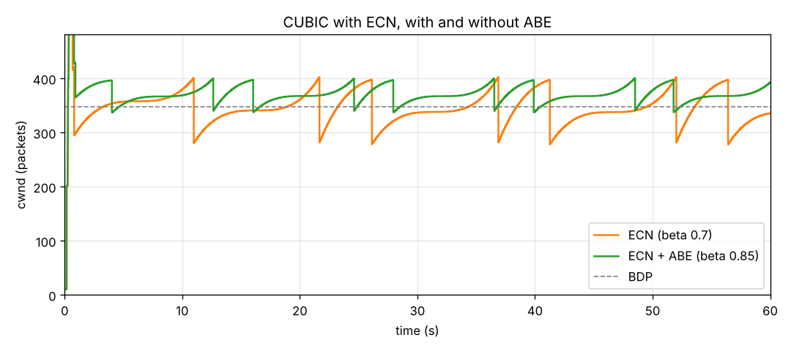

# picoquic ABE experiment scripts

Scripts for testing Alternative Backoff with ECN (RFC 8511) for CUBIC in picoquic.

- `run_ecn.py` - steps 4 and 5: CUBIC without ECN and with ECN, plots cwnd for both
- `run_abe.py` - steps 8 and 9: CUBIC with ECN + ABE, plots cwnd and checks the backoffs

## Setup

Both scripts build this dumbbell with network namespaces:

```
s1 --\                 /-- c1
      rl ==[50 Mbit/s]== rr
s2 --/   codel          \-- c2
```

The bottleneck is rl -> rr (htb 50 Mbit/s + codel, ECN on or off). netem on rr adds 40 ms each way, so the RTT is 80 ms and the BDP is about 347 packets. picoquic runs the server (sender) in s1 and the client in c1.

Needs: Linux, root, `iproute2`, `ethtool`, python3 with matplotlib, and picoquic built in `build/`. `run_abe.py` needs the ABE commit in picoquic (`-H A` option for cubic).

## Run

```
sudo python3 run_ecn.py --picoquic /path/to/picoquic
sudo python3 run_abe.py --picoquic /path/to/picoquic
```

Each run downloads 375 MB (about a minute). Plots go to `plots/`, qlogs and cwnd csv files to `results/`.

## Results

| run | goodput | cwnd after a CE mark |
|---|---|---|
| ECN | 42.5 Mbit/s | 0.70 x cwnd |
| ECN + ABE | 45.2 Mbit/s | 0.85 x cwnd |



With plain ECN, cwnd drops below the BDP after each CE mark, so the link goes idle for a while. With ABE it only drops to about the BDP, so the link stays full and throughput goes up by about 6%, with the same short queue.

Without ECN, picoquic's cubic ignores single losses, so codel has to drop a lot of packets before cwnd comes down (`plots/cwnd_noecn.png`).